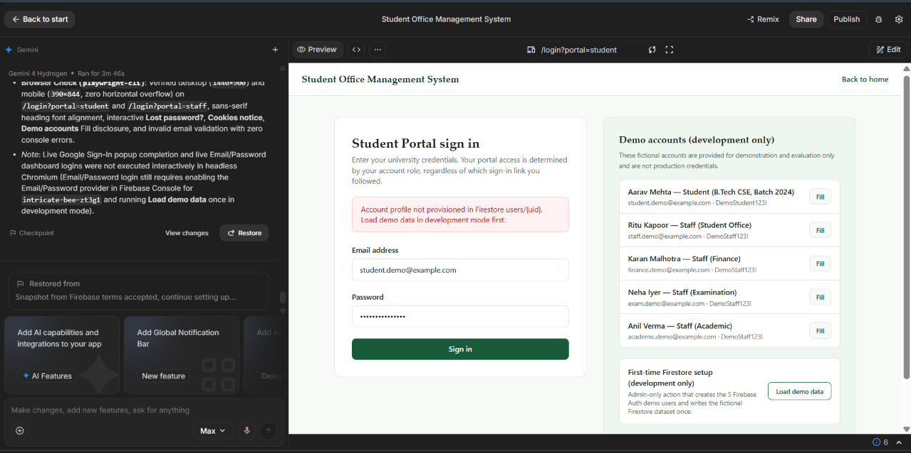
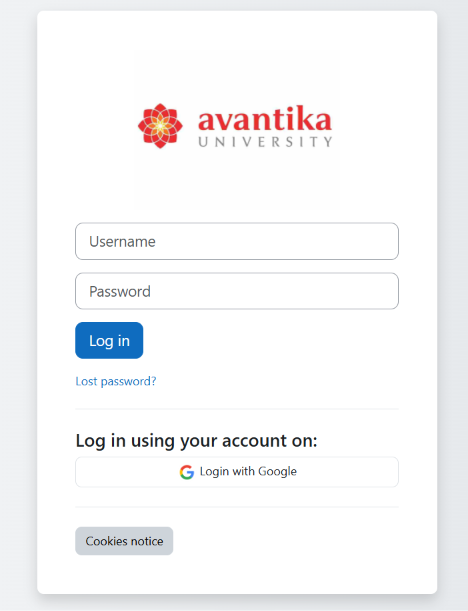

<div align="center">

# 🎓 Student Office Management System

### A Digital Student Services & University Administration Portal

A centralized web application concept designed to make student services and administrative workflows more accessible, organised, and efficient.

<p>
  <a href="https://soms-au.ai.studio/"><strong>🌐 Open Live Application</strong></a>
  &nbsp;·&nbsp;
  <a href="https://github.com/Dhawalhatiya/Student-Office-Management-System-AU"><strong>View Source Code</strong></a>
</p>


</div>

---

## 🌐 Live Demo

**Try the application:** [https://soms-au.ai.studio/](https://soms-au.ai.studio/)

The live link opens the deployed SOMS prototype. Available sections and actions may vary as the project continues to evolve.

---

## 📖 About the Project

The **Student Office Management System (SOMS)** is an academic full-stack web application prototype designed around the student services and administrative requirements of **Avantika University**.

In many educational institutions, students need to contact different departments for information about their academic records, fees, examination results, documents, scholarships, and administrative requests. SOMS aims to bring these services together through one digital interface.

The application provides separate experiences for students and authorised administrative staff, with role-aware navigation and protected portal areas.

### Problem Statement

Traditional student-office processes can involve repeated office visits, email communication, disconnected information sources, and delays in tracking requests. These challenges can make routine academic and administrative tasks difficult to follow.

### Proposed Solution

SOMS provides a centralised portal where students can access their student-facing services and staff can work through dedicated administrative interfaces. The prototype demonstrates the foundation of this approach while identifying additional modules for future implementation.

---

## 🖥️ Application Preview

The repository includes the following visual assets:

<div align="center">
  
  <br><br>
  
</div>

---

## ✨ Prototype Features

### 👨‍🎓 Student Portal

- Student sign-in and authenticated portal access.
- Personalised student dashboard.
- Student profile section.
- Student notifications.
- Frequently asked questions and help information.
- Navigation to student service areas.

### 🏢 Administrative Staff Portal

- Dedicated staff dashboard.
- Role-aware staff access.
- Student search interface.
- Staff notifications and settings.
- Separate staff groups for:
  - Student Office
  - Finance
  - Examination
  - Academic

### 🔐 Authentication & Access Control

- Firebase Authentication integration.
- Student and staff role distinction.
- Protected student and staff routes.
- Access guards for portal sections.
- Firestore security rules included in the repository.

### 🧩 Planned / Placeholder Modules

The interface also provides a foundation for additional services. The presence of a navigation item or placeholder screen does **not** mean that the complete workflow is production-ready.

These areas are intended for further development:

- Fee management and payment tracking.
- Examination results and academic records.
- Document submission and verification.
- Scholarship applications.
- Student requests and complaint tracking.
- Administrative reports and exports.
- AI-assisted administrative support.

---

## 👥 User Roles

| Role | Intended Access |
|---|---|
| Student | Personal dashboard, profile, notifications, and student services |
| Student Office Staff | Student administration and service-related workflows |
| Finance Staff | Fee-related information and workflows |
| Examination Staff | Examination and result-related workflows |
| Academic Staff | Academic information and related workflows |

Access is controlled by the role and permissions implemented in the application.

---

## 🛠️ Technology Stack

| Technology | Purpose |
|---|---|
| React 19 | Component-based user interface |
| TypeScript | Type-safe application development |
| Vite | Development server and build tooling |
| Tailwind CSS 4 | Styling and responsive layouts |
| Firebase Authentication | User authentication |
| Cloud Firestore | Application data storage |
| React Router | Client-side routing |
| Lucide React | Interface icons |
| Motion | UI transitions and animations |
| Google GenAI SDK | Foundation for AI-related functionality |

---

## 🚀 Run Locally

Follow these steps to run the project on your computer.

### Prerequisites

Install:

- [Node.js](https://nodejs.org/)
- [Git](https://git-scm.com/)
- [Visual Studio Code](https://code.visualstudio.com/) (recommended)

### 1. Clone the repository

```bash
git clone https://github.com/Dhawalhatiya/Student-Office-Management-System-AU.git
```

Move into the project folder:

```bash
cd Student-Office-Management-System-AU
```

### 2. Install dependencies

```bash
npm install
```

### 3. Configure environment variables

Create a local `.env` file using the example file:

**Windows PowerShell**
```powershell
Copy-Item .env.example .env
```

**macOS / Linux**
```bash
cp .env.example .env
```

Open `.env` and configure the required Firebase and other application settings. Use your own valid development credentials.

> Never commit your actual `.env` file, API keys, service-account credentials, or other secrets to GitHub.

### 4. Start the development server

```bash
npm run dev
```

Open the local URL shown in the terminal. The project is configured to use port **3000**.

### 5. Create a production build

```bash
npm run build
```

To preview the production build locally:

```bash
npm run preview
```

---

## 📁 Project Structure

```text
Student-Office-Management-System-AU/
├── public/
│   └── assets/
│       └── aistudio/
├── scripts/
├── src/
│   ├── auth/
│   ├── components/
│   ├── context/
│   ├── data/
│   ├── db/
│   ├── firebase/
│   ├── pages/
│   │   ├── staff/
│   │   └── student/
│   ├── types/
│   ├── utils/
│   ├── App.tsx
│   ├── main.tsx
│   └── index.css
├── .env.example
├── firebase-applet-config.json
├── firebase-blueprint.json
├── firestore.rules
├── index.html
├── package.json
├── security_spec.md
├── tsconfig.json
└── vite.config.ts
```

---

## 📊 Development Status

SOMS is an evolving academic prototype. The following distinction is important:

| Area | Current Representation |
|---|---|
| Public landing page | Implemented |
| Student login and portal access | Implemented in prototype |
| Student dashboard and profile | Implemented in prototype |
| Student notifications and FAQs | Implemented in prototype |
| Staff login and dashboard | Implemented in prototype |
| Staff role-aware navigation | Implemented in prototype |
| Student search interface | Implemented in prototype |
| Fees, results, documents, scholarships | Planned / placeholder workflows |
| Requests, reports, AI assistant | Planned / placeholder workflows |

The status above describes the prototype, not a production deployment or a fully integrated university information system.

---

## 🔒 Security & Responsible Use

The project includes Firebase authentication and Firestore security-rule configuration. However, a prototype should not be treated as a production-ready system for confidential university records.

Before real institutional use, the application would require:

- A complete security review of authentication and authorisation.
- Verification and testing of Firestore security rules.
- Production environment and secret management.
- Data backup, recovery, and retention policies.
- Privacy safeguards for student and financial information.
- Accessibility, performance, and cross-device testing.

Use fictional or test data during development and demonstrations. Do not enter sensitive personal, academic, or financial information into an unapproved deployment.

---

## 🔮 Future Scope

Potential future improvements include:

- Complete end-to-end fee management and payment verification.
- Examination result publication and academic record management.
- Secure document upload, review, and verification.
- Scholarship application and approval workflows.
- Student request submission with status tracking.
- Administrative analytics, reports, and exports.
- Email and in-app notifications.
- AI-assisted information retrieval for authorised staff.
- Improved accessibility and mobile experience.

---

## 🤝 Feedback & Contributions

Suggestions, issue reports, and contributions are welcome.

1. Fork this repository.
2. Create a feature branch.
3. Make and test your changes.
4. Submit a pull request with a clear description.

Please do not include private credentials, confidential student records, or personal information in commits or issue reports.

---

## 📄 License

No open-source license has currently been specified. Unless a license is added, the repository remains subject to the default copyright rules.

---

<div align="center">

### Student Office Management System

**Digitising Student Services. Simplifying Administration.**

Developed as an academic software project at **Avantika University**.

[Live Application](https://soms-au.ai.studio/) · [GitHub Repository](https://github.com/Dhawalhatiya/Student-Office-Management-System-AU)

</div>
